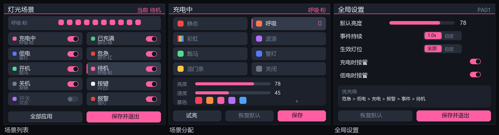
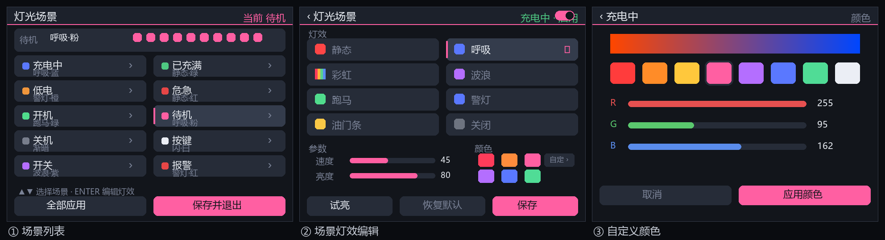
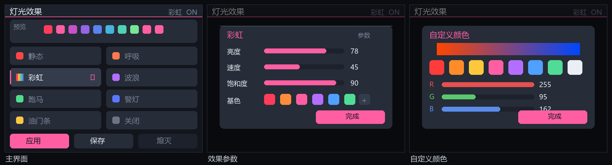

# PA01 定制固件（中文）

基于 [EdgeTX](https://github.com/EdgeTX/edgetx) 的**非官方**定制分支，面向 **FlySky PALADIN EV（PA01）** 遥控器。在官方源码基础上**重做了主界面顶栏、状态区、页面标题与组件配色（深色主题）**，扩展了 **RGB 灯效场景引擎**，并提供配套的中文 Lua 配置工具与定制 SD 卡内容。

> 本仓库与 FlySky、EdgeTX 官方均无关联，详见文末「免责声明」。

---

## 界面预览

| 场景列表 | 场景编辑 | 颜色设置 |
| --- | --- | --- |
|  |  |  |

---

## 主要改动

### 1. RGB 灯效场景引擎（固件）

新增文件：

- `radio/src/targets/pa01/led_scene.cpp`
- `radio/src/targets/pa01/led_scene.h`

接入点：

| 文件 | 作用 |
| --- | --- |
| `radio/src/targets/pa01/battery_driver.cpp` | 充电/开机阶段的周期调度 `ledSceneTick()` |
| `radio/src/targets/pa01/led_driver.cpp` | 场景接管时跳过原有开关灯逻辑 |
| `radio/src/edgetx.cpp` | 主界面 10ms 周期驱动、开机场景时序 |
| `radio/src/audio.cpp` | 报警音触发「报警」场景 |
| `radio/src/lua/api_general.cpp` | Lua 设置 LED 时临时让出灯带控制权 |

功能要点：

- 支持全部 **14 颗灯**：`0-7` 功能键 1-4、`8-9` 电源键、`10-11` 右侧环绕灯、`12-13` 左侧环绕灯。
- 9 个事件场景 + 1 个独立的电源键场景，按优先级自动切换：
  `开机 > 告急 > 低电 > 报警 > 充电中 > 已充满 > 油门 > 待机`
- 11 种灯效：静态、脉动、光谱、流动、循环、警灯、油门条（兼容保留）、星点、交替、光谱脉动。
- 每个场景可配置 **1~2 组颜色**（由所选灯效决定），如「交替」为左组/右组双色，「循环」为亮点/底色。
- 开机时间线：原厂电源键灯 → 播放配置中的「开机」场景 → 进入主界面后 600ms 交叉淡出到当前场景。
- 灯效行为完全由 `/RADIO/ledfx.cfg` 决定，固件不再内置默认灯效。

### 2. Lua 配置工具

- `pa01_sd/SCRIPTS/TOOLS/ledfx.lua`：工具菜单中的「LED 灯效」。
  - 场景列表：预览灯带、切换场景、一键全部应用、保存并退出
  - 场景编辑：灯效宫格、速度、亮度、颜色组、启用开关、恢复默认
  - 颜色页：预设色、自定义 RGB（长按方向键调值）
- `pa01_sd/RADIO/ledfx.cfg`：唯一配置源，工具保存后立即生效。
- 保存行为：编辑页「保存」或列表页「保存并退出」写盘；直接在列表页按 EXIT 时，若有改动会自动保存。列表页右上角显示「未保存」提示。

### 3. 界面与主题（PA01 UI）

针对 320×240 屏幕与深色配色，对 `radio/src/gui/colorlcd/` 做了以下调整（57 个文件，约 +1500 行）：

- **顶栏**：原版左上角的 EdgeTX 图标框替换为「强调点 + 机型名」品牌行；保留原有点击区域，点击仍可呼出快捷菜单；切换模型后机型名自动更新。
- **状态区**：日期（10px）与时间（17px）两行右对齐排布，文本变化后重新锚定，避免末位数字被裁切。
- **页面标题**：中文界面下父标题与标签标题相同时自动隐藏重复的一行，并垂直居中剩余标题。
- **快捷菜单**：分隔线与品牌徽标对齐到顶栏底边，形成通栏抽屉式效果。
- **主题配色**：以 PA01 深色底板为基准调整 `PRIMARY2` 等表面色与前景色对比，修正深色背景上标题不可读的问题。
- **主界面组件**：计时器、机型信息、通道输出、仪表、文本/数值、机型图片等重新排版与配色；对模型文件中保存的旧版浅色配色做**对比度回退**，避免文字在深色底板上消失。
- **中文支持**：内置简体中文字库与翻译（`-DTRANSLATIONS=CN` 构建），并对中文特有的长文本、重复标题做了布局适配。

### 4. 关机充电（界面 + 灯效）

- **充电画面**：关机插电充电时，LVGL 尚未启动，充电提示文字以 8-bit 透明蒙版位图直接写入帧缓冲，显示自定义中文「充电中 / 已充满」（`radio/src/targets/pa01/charge_text.h`，由 `build-tools/gen_charge_text.py` 生成）。
- **充电灯效**：同一状态下 RGB 灯带由场景引擎接管，按配置里的「充电中 / 已充满」场景显示灯效，充满后自动切换到「已充满」。
- 上电瞬间会先播放约 3 秒「开机」场景，随后进入充电场景。

### 5. 构建脚本

- `build_pa01_cn.cmd`：PA01 + 简体中文固件构建脚本
- `build_pa01.cmd`、`build_simu_*.cmd`：英文固件与本机模拟器构建脚本

---

## 灯效系统说明

### 场景与触发

| 场景 | 触发条件 |
| --- | --- |
| 充电中 / 已充满 | 充电状态 |
| 低电 / 告急 | 电量警告 / 电量低于 8% |
| 开机 | 上电后读取配置即播放 |
| 报警 | 系统警告音（`AU_WARNING1/2`） |
| 油门 | 油门通道（默认 CH3）超过设定百分比 |
| 待机 | 无其他场景时兜底 |
| 电源键 | 独立控制 8-9 号灯，常驻 |

### 颜色组

| 灯效 | 颜色组 | 用法 |
| --- | --- | --- |
| 静态 / 脉动 | 1 | 全部灯使用色 1 |
| 循环 | 2 | 色 1 亮点，色 2 底色 |
| 警灯 | 2 | 奇偶灯交替 色 1 / 色 2 |
| 星点 | 2 | 色 1 底色，色 2 光点 |
| 交替 | 2 | 左组色 1、右组色 2，定时互换 |
| 光谱 / 流动 / 光谱脉动 | 0 | 算法自动配色 |

### 配置文件格式

`/RADIO/ledfx.cfg`：

```
global=事件时长,生效灯位,总开关
场景=效果,速度,亮度,R,G,B,启用,触发,副色R,副色G,副色B
```

- `生效灯位`：`1` 功能键灯、`2` 电源键灯、`3` 全部
- `效果`：`0` 关闭 `1` 静态 `2` 脉动 `3` 光谱 `4` 流动 `5` 循环 `6` 警灯 `7` 油门条 `8` 星点 `9` 交替 `10` 光谱脉动
- `触发`：仅「油门」场景使用，`0` 表示不触发，其余为油门百分比
- 场景键名：`charge` `full` `low` `crit` `boot` `idle` `thr` `alarm` `pw`

---

## 编译

前置条件：

- Visual Studio 2022（含 C++ 工作负载）
- `arm-none-eabi` 工具链（默认位于 `D:\edgetx\build-tools\ArmGNU`）
- CMake + Ninja、Python 虚拟环境（默认位于 `D:\edgetx\build-tools\.venv`）

执行：

```bat
build_pa01_cn.cmd
```

产物：

```
build\pa01-cn\firmware.bin
build\pa01-cn\firmware.uf2
```

脚本中的路径为作者本机路径，请按实际情况修改。

---

## SD 卡内容

`pa01_sd/` 中收录了**定制部分**：

- `RADIO/ledfx.cfg`：灯效配置
- `SCRIPTS/TOOLS/ledfx.lua`：灯效配置工具
- `SCRIPTS/`：随卡附带的 Lua 脚本
- `IMAGES/`、`MODELS/`、`TEMPLATES/`：机型图片、模型与模板

`SOUNDS/`、`THEMES/`、`WIDGETS/` 为 EdgeTX 官方 SD 卡内容，体积较大，未纳入仓库，请从 EdgeTX 官方 SD 包获取后合并使用。

---

## 免责声明

1. 本固件为个人/社区兴趣项目，**非 FlySky 官方、非 EdgeTX 官方发布**，与上述公司及项目无任何隶属或背书关系。
2. 刷写非官方固件存在风险，可能导致设备无法启动、数据丢失或失去保修。**请自行评估风险，后果自负**。
3. 部分灯效依赖 PA01 特定 RGB 灯带硬件，其他机型不保证可用。
4. 使用本固件即表示你已知悉并接受上述风险；作者不对任何直接或间接损失承担责任。
5. 请遵守当地关于无线电设备与发射功率的法律法规。

## 许可证

本项目基于 EdgeTX，遵循 **GNU General Public License v2.0** 发布，保留原项目全部版权声明。
